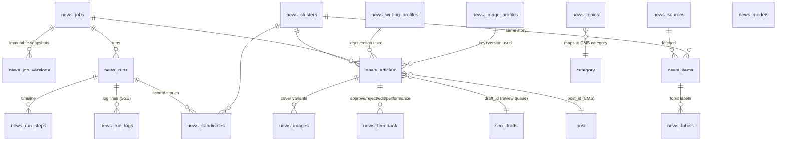

# AI News Desk: architecture

This repository is the news desk's engine (the news agent). The admin UI, admin API, review queue, publishing additions,
corrections and public pages are the web app's (moks-cms `src/app/admin/news`, `src/lib/news`, `docs/news/`).

The news desk adds configurable **news jobs** to the existing SEO platform. A job discovers stories from trusted
sources, ranks them with transparent (and later learned) scores, and has a crew of agents research, write, fact-check
and edit each one. Code quality gates check the result, a cover is made, and the draft lands in the existing review
queue. **Nothing auto-publishes**: publishing is the existing approval → `publish_flow` path, started only by a human
in the web review UI.

Where things run:

| Part | Where | Notes |
|---|---|---|
| Flows, ML, crew, quality gates, covers | this service, news-agent (`app/news/`, `app/flows/news.py`; split out of the seo-agent on 2026-11-21) | CrewAI Flows are the only orchestrator; ML steps are plain Python inside them |
| Fetching (SSRF-safe, robots.txt), CMS drafts, media storage, notifications | web app callback API (`src/lib/news/callbacks.ts`) | the agent's egress stays the Anthropic API (+ OpenAI Images only if configured) |
| Admin UI, admin API, review, publish additions, corrections, feed | web app (`src/app/admin/news`, `src/app/api/admin/news`, `src/lib/news`) | admin-only, same-origin, rate-limited, audited |
| Scheduling | rows `news-dispatch` (15 min), `news-train`, `news-style-review` of `seo_flow_schedules` (CrewAI console → Schedules) | one CronJob `news-flow-dispatcher` every minute → `POST /schedules/dispatch` here (jithendar.com `kubernetes/news-agent-60-dispatcher.yaml`) |
| Data | the shared Postgres, migration `0017_news_desk.sql` | 17 tables, additive; manual rollback script |

## Flows

```mermaid
flowchart LR
  CJ[schedule news-dispatch<br/>every 15 min] -->|news-flow-dispatcher → POST /schedules/dispatch| D[news_dispatch_flow]
  D -->|due jobs: cron in job time zone<br/>slot = job + minute| J[news_job_flow]
  UI[/admin/news<br/>Run now · Dry run/] --> J
  subgraph J1[news_job_flow]
    direction TB
    I[ingest · shared<br/>fetch → normalize → dedupe → cluster → classify → novelty] --> S[select · per job<br/>score v1/v2 → filters → threshold → caps → diversity]
  end
  J --> J1
  S -->|per selected story<br/>concurrency 2| DR[news_draft_flow]
  subgraph DR1[news_draft_flow]
    direction TB
    C[News Desk Crew<br/>researcher → analyst → writer → fact-checker → SEO editor → art director] --> Q[quality gates · code]
    Q -->|pass| IMG[cover image<br/>generate → safety → best → optimize → store → alt text]
    IMG --> SV[save: CMS draft post + review draft]
    Q -->|fail| FQ[failed_quality<br/>reasons in run detail]
  end
  DR --> DR1
  SV --> RQ[(review queue)]
  RQ -->|human approval in the web UI only| PF[publish_flow<br/>existing: publish → verify → submit]
```

Other flows: `news_ingest_flow` ("test source" / fetch now), `news_image_flow` (regenerate a cover from review),
`news_train_flow` (weekly: classifier + ranker), `news_style_review_flow` (weekly: proposes a writing-profile version),
`news_playground_flow` (profile A/B; saves nothing). None of them references `publish_flow` or the web app's publish
callback; a static test and a runtime test check that (`tests/test_news_flows.py`).

### Locks, idempotency, caps

- One active run per job: the flow runner's partial unique index + a Postgres advisory lock on target `job:<id>`
  (v4 D-57). One active draft run per job + story (`<job>:<cluster>:<mode>`).
- Scheduled slots run once: `news_runs (job_id, slot)` is unique.
- Ingestion is shared: a source fetched within its interval is skipped by every job; one ingest at a time (in-process
  lock; the agent is a single replica with `Recreate`).
- One active draft per story per job: `news_articles` partial unique index; another job's open draft or any published
  article for the story is a duplicate.
- Caps (per run, per day in the job's time zone, global per day) are counted from `news_articles` and the run's own
  selections. Every LLM call is held against the one LLM budget in the seo-agent first (`app/seo_agent.py`); image
  generation is checked against the news desk's image caps (`app/news/budget.py`).
- Rerun / "retry failed drafts" are idempotent: covered stories are skipped; only the parent run's selected stories that
  did not reach review are drafted again.

## Data model

| Table | Written by | Purpose |
|---|---|---|
| `news_sources` | admin UI (config), agent (health) | feed/API, credibility, interval, ETag/Last-Modified, health counters |
| `news_jobs`, `news_job_versions` | admin UI | job config (columns + validated `config` JSON); every save is a version with a diff |
| `news_writing_profiles`, `news_image_profiles` | admin UI; style review adds `proposed` versions | versioned prompts; one `active` per key |
| `news_topics` | admin UI | taxonomy → CMS `category.slug`, keywords, suggested tags |
| `news_items` | agent | every fetched item: normalised URL, hashes, SimHash, MinHash, embedding (`real[]`), entities, language |
| `news_clusters` | agent | stories: centroid, entities, CVEs, source count, burst, status, topics, site match |
| `news_candidates` | agent | per run: features, score, breakdown, model version, decision + reason |
| `news_articles` | agent; web (review outcome) | one per draft attempt: sources, fact sheet, gate reports, generated document, cost, outcome, edit distance |
| `news_images` | agent | provider, prompt, seed, sizes, alt text, AI flag, safety verdict, selected |
| `news_runs`, `news_run_steps`, `news_run_logs` | agent | run history, timeline, structured logs (retention 90 days) |
| `news_feedback` | web (decisions, performance), agent (MCP reject) | the learning loop's labels |
| `news_labels`, `news_models` | agent; web (category corrections) | classifier labels; versioned models with metrics |

Embeddings are `real[]`, not pgvector (DECISIONS N-02). CMS posts and review drafts stay in the existing `post` and
`seo_drafts` tables; the news tables reference them by id.

## Security boundaries

- **Publishing**: only `publish_flow`, only from a recorded human approval (v3 D-43, v4 D-56). News adds two small pieces
  inside `publishNewArticle` (news metadata on the patch, bookkeeping after success) and nothing that can call it.
- **Agent writes**: news tables; CMS changes only through the callback API (`/news/drafts` creates a *draft* post and an
  agent-owned review draft; `/news/drafts/{id}/image` changes a draft's cover while it waits for review).
- **Fetching**: allowlisted https hosts only, DNS resolved in the socket with private ranges refused, robots.txt honoured,
  paywalled hosts refused, size/time limits (DECISIONS N-05).
- **Prompt injection**: source text enters only as delimited data blocks with closing tags neutralised; agents hold
  read-only tools; outputs are Pydantic-validated and then checked by code gates.
- **MCP**: none. The seo-agent's admin MCP news tools were dropped with the split (the admin MCP was off); a news MCP
  can be added here later.
- **Callback token**: `NEWS_AGENT_CALLBACK_TOKEN` is the news agent's own; the web app accepts it on the news routes,
  Search Console queries, skills, crew configurations and run-history settings only (`app/webapp.py` CALLBACK_ROUTES),
  never on drafts or publishing.
- **The seo-agent**: `SEO_AGENT_NEWS_TOKEN` reaches only `POST /search` (site match, the crew's site search) and the
  one LLM budget's `POST /llm-budget/reserve|settle` (`app/seo_agent.py`).
